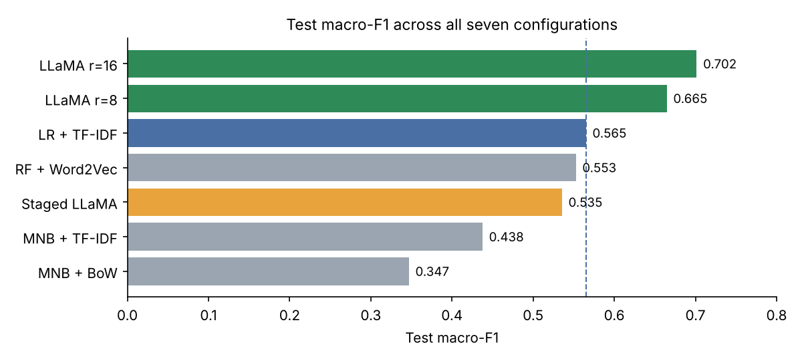
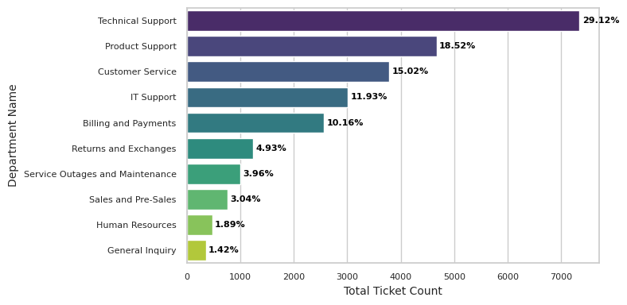
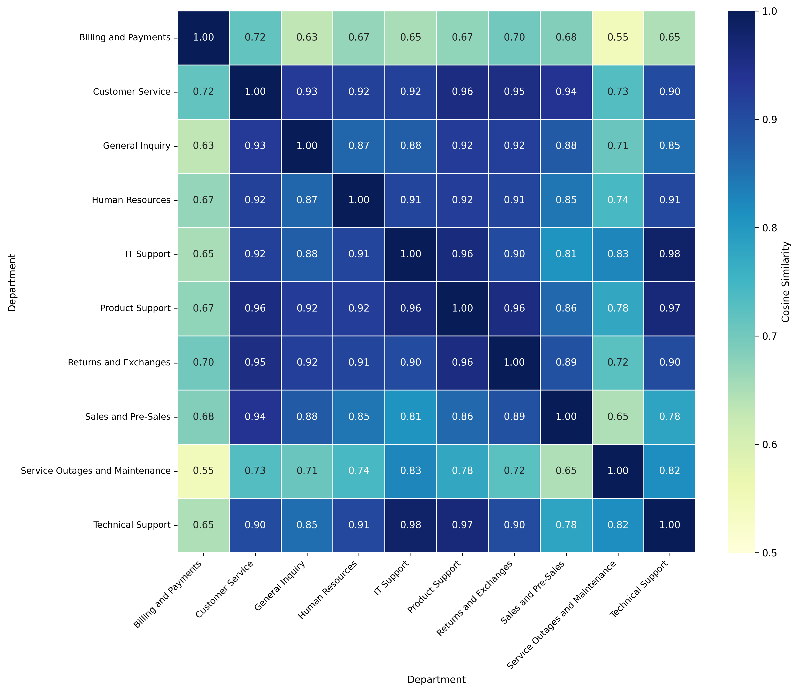
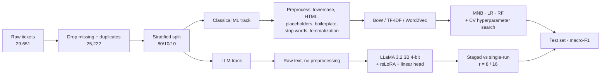
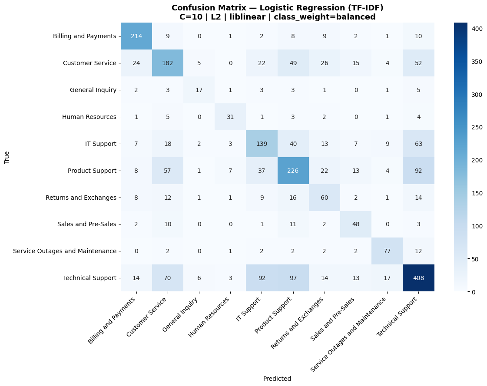
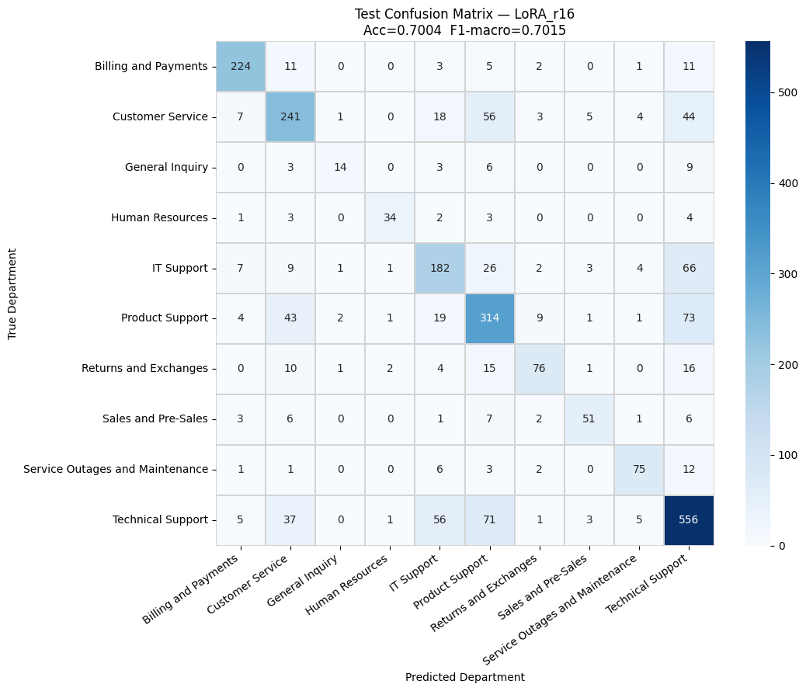

# From Bag-of-Words to Specialized LLMs

**A comparative study of classical ML and LoRA fine-tuned LLaMA 3.2 3B for automated IT support ticket routing**

Bachelor thesis · FH Dortmund, Department of Computer Science · 2026
Author: Moustafa Elmehy · Supervisors: Prof. Dr. Nadja Bauer, Prof. Dr. Klaus Kaiser

   

---

## TL;DR

Support tickets have to reach the right department. This project classifies tickets into **10 departments** and compares four classical ML pipelines against parameter-efficient fine-tuning of **LLaMA 3.2 3B** (4-bit QLoRA + rsLoRA), all on the same deduplicated corpus and the same stratified split.

| | Macro-F1 (test) |
|---|---|
| Best classical: **Logistic Regression + TF-IDF** | 0.565 |
| Best LLM: **LLaMA 3.2 3B, single-run, LoRA r=16** | **0.702** (+13.6 pp) |
| Same LLM, **staged** training | 0.535 (below the classical baseline) |

Key takeaways:

1. **Fine-tuned LLMs win clearly**, mostly on semantically overlapping departments (IT / Technical / Product Support) where bag-of-words features can't separate classes.
2. **Training strategy matters more than compute.** The staged procedure used *more* GPU time than single-run training and still lost to Logistic Regression.
3. **LR + TF-IDF stays the pragmatic choice** under resource constraints: CPU-only, no paid GPU, and 0.001 ms/sample inference.



---

## Problem

Manual ticket triage is slow and does not scale. The task is **single-label, multi-class text classification**: given the ticket body, predict one of 10 mutually exclusive departments.

The thesis answers three research questions:

- **RQ1** How large is the performance gap between classical ML and parameter-efficient LLM fine-tuning?
- **RQ2** Is that gap large enough to justify the extra compute and cost?
- **RQ3** How do training strategy and LoRA configuration shape the quality-vs-resources trade-off?

## Dataset

[IT Support Ticket Data (Kaggle)](https://www.kaggle.com/datasets/parthpatil256/it-support-ticket-data). The CSV is not included in this repo; download it from Kaggle.

| Step | Rows |
|---|---|
| Raw records | 29,651 |
| Missing ticket body removed | −1 |
| Exact duplicates removed | −4,428 |
| **Final corpus** | **25,222** |

Split: **80 / 10 / 10** train / validation / test, stratified by department, `random_state=42`. The identical split is used for every model so results are directly comparable.

**Class imbalance is ~20:1**, from Technical Support (29%) down to General Inquiry (1.4%). That's why **macro-F1** is the primary metric throughout.



> **A note on data leakage.** About 25% of test tickets had an exact copy in the training set before deduplication. Early LLM runs on the raw corpus reported inflated scores (≈0.77 macro-F1). All results in this README come from the **deduplicated** corpus; the notebooks still contain the earlier runs, clearly labelled as "with data leakage", for transparency.

### Why this is hard

Several departments are almost indistinguishable at the word level. The TF-IDF centroid similarity between **IT Support and Technical Support is 0.98**, and between Product Support and Technical Support it is 0.97.



## Method



### Classical ML track

Text is cleaned before vectorization: lowercasing, HTML stripping, removal of anonymization placeholders (`tel_num`, `acc_num`, `[Your Name]`, …), removal of email boilerplate ("Dear support team", "Thank you for your time", …), stop-word removal and WordNet lemmatization.

| Model | Features | Tuning |
|---|---|---|
| Multinomial Naive Bayes (baseline) | Bag-of-Words | none (defaults) |
| Multinomial Naive Bayes | TF-IDF (1–2 grams, 10k features) | GridSearchCV over `alpha`, `fit_prior` |
| Logistic Regression | TF-IDF (1–2 grams, 10k features) | GridSearchCV over `C`, penalty, solver → `C=10, L2, liblinear` |
| Random Forest | Word2Vec (100-d, mean-pooled, trained on train split only) | RandomizedSearchCV, 30 candidates |

### LLM track

Embedding-based classification, following Yousefiramandi & Cooney (2025): the decoder's **last non-padding token** is pooled and passed to a single linear head. The model sees the **raw ticket text**.

| Setting | Value |
|---|---|
| Backbone | `unsloth/Llama-3.2-3B-bnb-4bit` (base, 4-bit NF4) |
| Adapters | rsLoRA on all attention + MLP projections, α = 2r, dropout 0.05 |
| Head | `Linear(3072 → 10)` in fp32 |
| Max sequence length | 256 tokens (covers >99.5% of tickets) |
| Optimizer | AdamW 8-bit, lr 2e-4, linear decay, no warmup |
| Effective batch | 32 (2 × 16 gradient accumulation) |
| Epochs / early stopping | 3 / patience 2 on validation macro-F1 |
| Hardware | single NVIDIA Tesla T4 (16 GB), Google Colab |

Two training strategies were compared with identical hyperparameters:

- **Staged**: training data split into 7 stratified, non-overlapping stages of 2,800 tickets, trained sequentially.
- **Single-run**: the full training partition in every epoch. Evaluated at LoRA rank **r = 8** and **r = 16**.

## Results

All numbers are on the held-out test set of the deduplicated corpus.

| Model | Representation | Accuracy | Macro-F1 | Train time | Hardware |
|---|---|---|---|---|---|
| MNB (default) | BoW | 0.398 | 0.347 | 0.05 s | CPU |
| MNB (tuned) | TF-IDF | 0.444 | 0.438 | < 1 min | CPU |
| Logistic Regression (tuned) | TF-IDF | 0.556 | 0.565 | 71.9 min* | CPU |
| Random Forest (tuned) | Word2Vec | 0.578 | 0.553 | 62.4 min* | CPU |
| LLaMA 3.2 3B, staged | contextual | 0.575 | 0.536 | ≈ 7 h | T4 GPU |
| LLaMA 3.2 3B, single-run, r = 8 | contextual | 0.688 | 0.665 | ≈ 4 h 45 min | T4 GPU |
| **LLaMA 3.2 3B, single-run, r = 16** | contextual | **0.700** | **0.702** | ≈ 5 h 15 min | T4 GPU |

\* includes the full cross-validated hyperparameter search. The final LR fit alone takes about 8 s.

### Where the LLM helps

Confusion matrices for the best classical model and the best LLM. The classical pipeline pushes many tickets into the dominant **Technical Support** class. The fine-tuned LLM reduces this considerably, e.g. Product Support → Technical Support errors fall from 92 to 73, and Technical Support recall rises from 408 to 556 correct tickets.

| Logistic Regression + TF-IDF | LLaMA 3.2 3B, r = 16 |
|---|---|
|  |  |

### Answers to the research questions

- **RQ1:** The best LLM beats the strongest classical baseline by **13.6 pp macro-F1**, with the gain concentrated in lexically similar departments.
- **RQ2:** It depends on context. Where misrouting is costly, the gain justifies a GPU. Under tight resources, LR + TF-IDF is a strong, free, immediately deployable baseline.
- **RQ3:** Single-run beats staged training by **16.6 pp** at lower cost, so the strategy outweighs the compute budget. Dropping from r = 16 to r = 8 saves ~30 minutes for −0.037 macro-F1, with the losses concentrated in small classes (Returns and Exchanges, Sales and Pre-Sales).

## Repository structure

```
.
├── notebooks/
│   ├── 01_eda_preprocessing_classical_ml.ipynb   # EDA, cleaning, MNB / LR / RF
│   ├── 02_llama32_3b_staged.ipynb                # LLM experiment 1: staged training
│   └── 03_llama32_3b_single_run.ipynb            # LLM experiment 2: single-run, r = 8 / 16
├── assets/                                       # figures used in this README
└── README.md
```

## Reproducing

The notebooks were written for **Google Colab** with a **T4 GPU** and read data from Google Drive.

1. Download `IT Support Ticket Data.csv` from Kaggle and place it in your Drive at `MyDrive/IT Support Ticket Data.csv`, or edit `DATA_PATH` / `file_path` in the notebooks.
2. **Classical ML:** run `01_...ipynb` top to bottom. CPU is enough. It saves the cleaned dataset to Drive as `df_ml_cleaned.csv`.
3. **LLM:** open `02_...` or `03_...` in Colab with a T4 runtime and run the install cell first. Checkpoints (LoRA adapters + classifier head) are saved to Drive after every epoch, so a run interrupted by a Colab timeout can be resumed.

Main libraries: `pandas`, `scikit-learn`, `nltk`, `gensim`, `sentence-transformers`, `unsloth`, `peft`, `transformers`, `bitsandbytes`, `torch`.

## Limitations and future work

- Single-seed point estimates; multi-seed runs would give variance estimates.
- 3B backbone limited by T4 VRAM; larger models may scale further.
- No comparison yet with fine-tuned encoder models (BERT / SBERT).
- Ticket metadata (priority, tags) was not used as input.
- The Technical / Product / IT Support cluster may be partly a labelling problem; active learning with expert re-annotation could help.

## Reference

The LLM setup follows: A. Yousefiramandi and C. Cooney, *Fine-tuning causal LLMs for text classification: Embedding-based vs. instruction-based approaches*, arXiv:2512.12677, 2025.

## Citation

```bibtex
@thesis{elmehy2026ticketclassification,
  author = {Moustafa Elmehy},
  title  = {From Bag-of-Words to Specialized LLMs: A Comparative Analysis of NLP Methods for Automated IT Support Ticket Classification},
  school = {Dortmund University of Applied Sciences and Arts (FH Dortmund)},
  type   = {Bachelor's thesis},
  year   = {2026}
}
```
